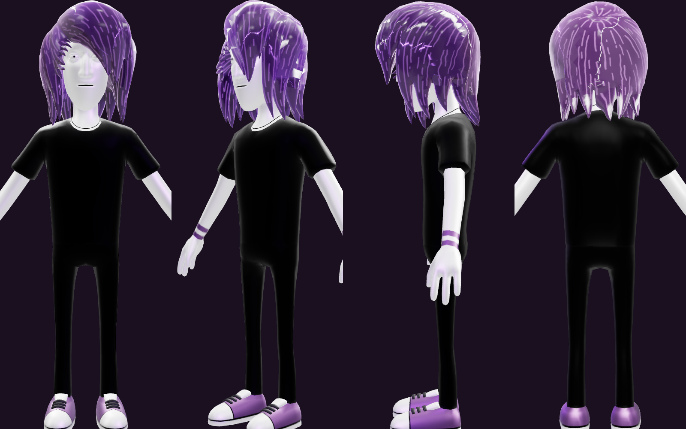

# Emonad model assets

Source files for the Emonad character, copied from the Number Go Up project folder
(`/Volumes/BJ/code/emonad projects/playground/promo/emopromo` on the external drive).

## Files

| File | What it is |
|------|------------|
| `model/emonad.glb` | Game-ready model (Blender glTF export). This is the one to load in three.js. |
| `model/emonad_mixamo.fbx` | Same character rigged by Mixamo, A-pose, no animation. |
| `animations/hip_hop_dancing.fbx` | Mixamo clip, 4.7 s |
| `animations/hip_hop_dancing_1.fbx` | Mixamo clip, 5.2 s |
| `animations/hip_hop_dancing_2.fbx` | Mixamo clip, 6.3 s |
| `animations/northern_soul_spin.fbx` | Mixamo clip, 4.0 s |

## `emonad.glb` facts

- 3.3 MB. About 2.3 MB of that is five PNG textures (the hair base map alone is 1.3 MB),
  so converting textures to WebP or KTX2 should cut the file a lot.
- Two meshes: `BODY` (8,156 verts, 10,356 tris, skinned) and `HAIR` (2,581 verts, 4,085 tris).
  `HAIR` is not skinned; it is parented to the `Head` bone and moves rigidly with it.
- Rest pose is an A-pose. About 9.6 units tall, feet at y = 0. He faces -Z, so a camera
  has to sit on the -Z side to see his face (three.js's default camera at +Z sees his back).
- No animations inside the GLB.
- Skeleton `VRM_Armature`, 53 joints with VRM humanoid names:
  `Hips, Spine, Chest, Neck, Head, Jaw, LeftEye, RightEye, Hair_Root, Hair_Mid, Hair_Tip,
  Left/RightShoulder, Left/RightUpperArm, Left/RightLowerArm, Left/RightHand` (plus fingers),
  `Left/RightUpperLeg, Left/RightLowerLeg, Left/RightFoot`.
- Morph targets on `BODY` (VRM expressions): `Blink, BlinkLeft, BlinkRight, LookUp, LookDown,
  LookLeft, LookRight, A, I, U, E, O, Joy, Angry, Sorrow, Surprise, Neutral`, plus 15 `vrc.v_*` visemes.
- Morph targets on `HAIR`: `Sway_Left, Sway_Right, Sway_Forward, Bounce`.
- Material extensions used: clearcoat, specular, sheen, anisotropy (hair).

## Animation FBX facts

The Mixamo files use `mixamorig:*` bone names (57 bones, 24 fps), not the VRM names in the GLB,
so the clips need retargeting (or a re-export from Blender onto the GLB rig) before they play on
`emonad.glb`. Name map for the main bones:

| Mixamo | GLB |
|--------|-----|
| `Hips` | `Hips` |
| `Spine` | `Spine` |
| `Spine1` + `Spine2` | `Chest` |
| `Neck`, `Head` | `Neck`, `Head` |
| `LeftShoulder`, `LeftArm`, `LeftForeArm`, `LeftHand` | `LeftShoulder`, `LeftUpperArm`, `LeftLowerArm`, `LeftHand` |
| `LeftUpLeg`, `LeftLeg`, `LeftFoot` | `LeftUpperLeg`, `LeftLowerLeg`, `LeftFoot` |

Right side is the same with `Right` in place of `Left`.
